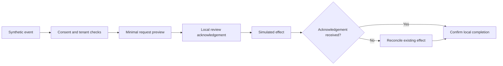

# Discovery

> Status: **Populated — discovery worksheet and repository-backed worked example.**

Capture the current process, authority and failure evidence before selecting an automation platform. This guide implements the discovery phase of the [consulting methodology](../01%20Consulting%20Methodology/README.md) using the existing synthetic contact-handoff example. It is a reusable worksheet, not a record of interviews with a real client.

## Intake worksheet

| Question to resolve | Evidence to collect | Contact-handoff example |
|---|---|---|
| What starts the work? | Trigger, source owner, event identity and expected volume | Explicit synthetic event with `projectId` and `eventId`; no authenticated webhook ingestion |
| What is the system of record? | Owner, canonical identifiers and allowed updates | Local contact simulator matches location plus normalized email; domain records remain in their own system |
| Who can authorize an effect? | Named role, authentication source and approval scope | Reviewer label acknowledges a local receipt; it does not authenticate an operator or authorize messaging |
| What data is necessary? | Field classification, storage consent and retention owner | Email, optional names and source only; no phone, free text, financial details or clinical records |
| What constitutes a duplicate? | Stable identity, changed-payload policy and replay examples | Planner correlation key is location/project/event; durable workshop rejects a changed minimized payload under the same event identity |
| What happens after a timeout? | Remote lookup capability, retry budget and escalation owner | Local workshop blocks retry of an uncertain write until reconciliation; hosted behavior remains unverified |
| What does success mean? | Observable destination state and acceptance owner | Confirmed local effect and source-bound receipt, with external action count zero |

## Worked current-state map



The [pure planner](../integrations/ghl-n8n/contract.mjs) performs validation and returns a request preview without I/O. The separate [durable workshop](../demo-lab/reliability.mjs) stores intent, minimized payload hash, source identity, transitions and local effect. Do not infer durability from the planner's event key alone.

## Collect reproducible exceptions

From the repository root after [setup](../38%20Deployment/README.md):

```powershell
node --test tests/ghl-n8n.test.mjs demo-lab/reliability.test.mjs
```

Inspect missing consent, tenant mismatch, changed identity payload, confirmed failure before a write, acknowledgement lost after a write, retry exhaustion and restart recovery. The [workshop runbook](../demo-lab/RELIABILITY-WORKSHOP.md) explains how to exercise the local lifecycle in the UI.

For a real discovery session, request redacted examples through an approved private channel. Keep raw customer records, connector credentials and client-specific process maps outside this public repository. Record which input identities and permission fields come from trusted connectors rather than requester-provided text.

## Discovery exit criteria

Deliver an owner-reviewed current-state map, a field/authority inventory, explicit duplicate and uncertain-outcome rules, measurable baseline definitions and a list of unresolved assumptions. Advance each requirement through the [business-analysis traceability table](../03%20Business%20Analysis/README.md). Provider authorization, actual volumes, retention requirements and operational baseline measurements remain unresolved for the public synthetic example.

---
*Part of the [Enterprise Automation Portfolio](../README.md).*
