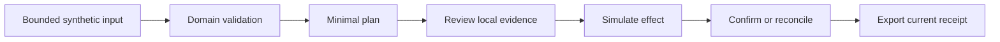

# Automation framework

> Status: **Populated — implemented local architecture and platform-selection criteria.**

The portfolio separates deterministic domain decisions, minimal contact planning, orchestration, durable recovery and review evidence. Select a platform against those boundaries instead of assuming that a successful connector call establishes business correctness.

## Existing layers

| Layer | Concrete source | Contract and limit |
|---|---|---|
| Domain decision | [Invoice matcher](../16%20Accounting/ACC-01%20Accounts%20Payable%20Match%20and%20Cash%20Control/build/invoice_matcher.py), [industry evaluators](../demo-lab/industry-depth.mjs) | Calculate a draft, hold or proposal from synthetic evidence; no payment/dispatch authority |
| Structured evidence graph | [AtlasGraph](../demo-lab/atlasgraph-core.mjs) | Version supplied pages/claims/quoted references, traverse approved local graph and abstain on missing/conflicting/budget-limited evidence; no model extraction or semantic answer verification |
| Minimal contact plan | [Shared planner](../integrations/ghl-n8n/contract.mjs) | Trusted configuration selects tenant/project; consent and allowed fields precede a request preview; no I/O |
| Local orchestration | [RE-01 n8n wrapper](../demo-lab/workflows/RE-01.json), [server](../demo-lab/server.mjs) | Real local n8n runs a domain demo, planner, simulator upsert and result verification |
| Durable recovery | [Reliability controller](../demo-lab/reliability.mjs) | Transactional local intent/effect/event state, bounded retry and reconciliation; not distributed exactly-once delivery |
| Review evidence | [Flagship controller](../demo-lab/flagship-suite.mjs), [governor](../PORTFOLIO-AGENTS.md) | Source-bound receipts and automated local gates; labels do not authenticate reviewers |

Two workflow families have different effects. The generated packages under [showcase](../showcase/README.md) stop at a request preview. The [demo-lab wrappers](../demo-lab/README.md) additionally make loopback HTTP calls and write to a local SQLite contact simulator. Neither proves execution of every original production-workflow node or hosted-provider acceptance.

## Platform-selection worksheet

| Decision | Evidence required before selection |
|---|---|
| Run existing local n8n wrappers | Installed lockfile dependencies, exact wrapper compatibility, loopback lab and synthetic fixture acceptance |
| Translate to [Make.com](../22%20Make.com/README.md) or [Zapier](../23%20Zapier/README.md) | Verified native artifact, equivalent branch/error semantics, credential mapping, replay behavior and sandbox execution; currently not supplied |
| Keep a rule in code | A deterministic contract with unit/adverse tests, explicit input bounds and a stable domain owner |
| Add a hosted integration | Authorized sandbox, trusted identity/permission source, observed destination state, timeout reconciliation and redacted evidence |
| Add model inference | A task-specific evaluation dataset, abstention/permission rules, independently observed quality/cost and explicit provider authorization |

Do not choose a platform from an unmeasured feature/cost comparison. A native implementation must preserve the requirements in [business analysis](../03%20Business%20Analysis/README.md), including failure paths and operator takeover.

## Default local flow

The [API reference](../30%20API%20Documentation/README.md) documents local Host/Origin and intent-header checks. They reduce browser exposure but do not provide user authentication. Keep the lab on loopback, exclude private records and distinguish source manifests from complete automatic dependency discovery.

## Acceptance before expanding scope

Use the [local runbook](../38%20Deployment/README.md), reproduce relevant success and adverse cases, inspect the complete diff, and run applicable quality/governor checks from the [review handoff](../REVIEW-HANDOFF.md). A source change invalidates affected evidence. Production deployment, authenticated operator permissions, real-provider reconciliation and client business results remain separate acceptance work.

---
*Part of the [Enterprise Automation Portfolio](../README.md).*
